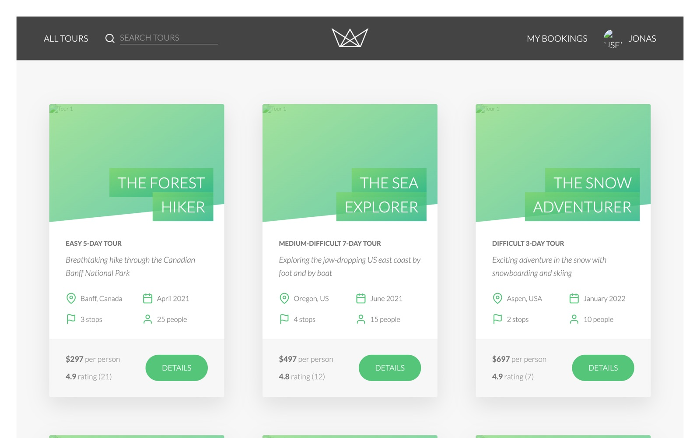

<div align="center">

# 🏔️ Natours

A tour-booking backend built with Node.js, Express and MongoDB, following an MVC structure.

<a href="https://github.com/miladmo68/natours"></a>
<a href="https://miladweb.com"></a>

</div>

<p align="center">
  
</p>

## ✨ Features

- REST API for tours and users
- Express routes, controllers and models
- MongoDB with Mongoose

## 🛠️ Tech Stack

     

> [!NOTE]
> This project needs its own backend, database or API keys, so it runs locally rather than as a static demo.

## 🚀 Getting Started

**Prerequisites:** [Node.js](https://nodejs.org/) 18 or newer · A MongoDB database (local or MongoDB Atlas)

**Install and run**

```bash
git clone https://github.com/miladmo68/natours.git
cd natours
npm install
npm start
```

### Environment variables

Create a `.env` file (or `.env.local` for Next.js) with:

```env
DATABASE=
DATABASE_PASSWORD=
PORT=
```

## 📁 Project Structure

```
natours/
├── controllers/
├── dev-data/
├── models/
├── public/
├── routes/
├── utils/
├── app.js
├── config.env
├── eslint.config.js
├── package.json
└── server.js
```

## 👤 Author

**Milad Mohammadi** — Frontend-Focused Full-Stack Developer, Toronto 🇨🇦

[](https://miladweb.com)
[](https://www.linkedin.com/in/miladmo68/)
[](https://github.com/miladmo68)

<p align="center"><sub>If you like this project, consider giving it a ⭐</sub></p>
